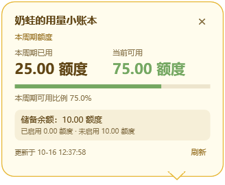

# 奶蛙 Codex 桌宠

原版奶蛙动画桌宠，附可选的 Windows 用量按钮、气泡和低额度提醒。用量服务由用户自行接入；下载后没有预置账号、接口或密钥。


## 一句话接入（通用版，含用量和音效）

将下面这句话复制给本机 Codex，让它按仓库说明完成安装和配置：

```text
请从 https://github.com/AkaCMD/naifrog-desktop-pet 下载并安装奶蛙 Codex 桌宠，阅读 README.md、usage/README.md 和 sound/README.md，使用 Install.ps1 -WithUsage 安装用量组件，根据我提供的用量服务 API 文档或查询方式、所需凭据和计量单位创建 Provider.Local.ps1 并配置真实用量、气泡及低额度提醒，同时使用我提供的有权使用的本地 WAV 配置任务完成音效；缺少接入资料或 WAV 路径时向我询问，凭据只在本机安全输入和保存，不写入源码或提交 Git，不用示例数据冒充真实用量，修改 config.toml 前先备份并保留原 notify，最后验证用量刷新和音效播放，并告诉我如何重启 Codex、选择奶蛙和卸载。
```

适用于 Windows 10/11；音效需要 Python 3.11+ 及支持 `notify` 的 Codex。请准备用量服务的 API 文档或查询方式、计量单位，以及有权使用的本地 WAV 路径。公开仓库不包含服务凭据或 WAV，提示词会引导 Codex 在本机补齐配置。

## 下载与安装

到 [Releases](https://github.com/AkaCMD/naifrog-desktop-pet/releases/latest) 下载 `naifrog-desktop-pet-v1.0.1.zip`，解压后进入文件夹。

要求：支持自定义桌宠的 Codex 桌面版。安装脚本及用量组件要求 Windows 10/11、Windows PowerShell 5.1；自备音效额外需要 Python 3.11+。

在解压目录打开 PowerShell，只安装桌宠：

```powershell
powershell.exe -NoProfile -ExecutionPolicy Bypass -File .\Install.ps1
```

同时安装用量显示：

```powershell
powershell.exe -NoProfile -ExecutionPolicy Bypass -File .\Install.ps1 -WithUsage
```

重启 Codex，在 **设置 → 外观 → 桌宠** 中选择 **奶蛙**。安装使用独立 ID `naifrog`，不会替换其他桌宠。也可手动将 `pet/` 内两个文件复制到 `~/.codex/pets/naifrog/`。

用量组件使用当前用户的启动项和 `Naifrog Usage Supervisor` 计划任务自动启动，在奶蛙可见时显示按钮。安装后未接入会显示 **未接入**，请按 [用量接入说明](usage/README.md) 配置。它不是 Codex 官方用量接口，也不会自动读取任何服务的账户凭据。

已安装版本再次运行安装命令即可更新，保留用量设置和自定义适配器。`-NoStart` 可在更新时不启动辅助程序。用量组件跟随 Codex 暴露的 UI 元素，应用升级可能需要调整；若任务计划注册失败，桌宠文件仍已安装，可按用量文档手动启动。



上图为虚构演示数据，不代表真实账户用量。

## 可选音效

公开包不包含音效 WAV。你可以使用已获授权的本地 WAV，按 [音效配置说明](sound/README.md) 设置完成提示。

## 卸载

在解压目录执行：

```powershell
powershell.exe -NoProfile -ExecutionPolicy Bypass -File .\Uninstall.ps1
```

卸载只删除 `~/.codex/pets/naifrog/` 及匹配该路径的用量启动项、任务和进程。请先备份自己的适配器与设置。音效通知为手动配置，需自行恢复原来的 `notify`。

## 开发验证

```powershell
powershell.exe -NoProfile -ExecutionPolicy Bypass -File .\tests\Test.Usage.ps1
powershell.exe -NoProfile -ExecutionPolicy Bypass -File .\usage\Test.Regression.ps1
```

素材来源、修改说明和第三方许可见 [NOTICE.md](NOTICE.md)。本项目代码采用 [MIT](LICENSE)。

## v1.0.1 更新

删除脚边右侧蓝色活动按钮，仅保留居中的“用量”按钮。用量气泡和额度提醒继续通过该按钮使用。已安装用户重新运行原安装命令即可更新。
